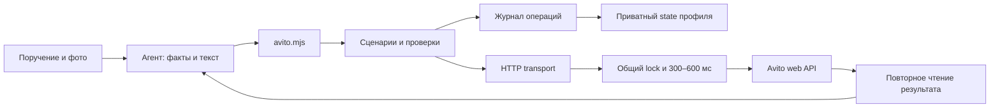

# Устройство

Один переносимый skill: SKILL.md маршрутизирует сценарий, references дают контракт, scripts выполняют точные операции. MCP и постоянный процесс отсутствуют. API-команды — короткие Node.js процессы с встроенными библиотеками. Только `auth login` на время ручного входа запускает loopback-страницу подключения и CDP-соединение с браузером.

- **Агент** выбирает товар/категорию по смыслу, пишет правдивое описание, уточняет неизвестные факты, соблюдает поручение. Он не получает cookie в контекст и не генерирует HTTP-код.
- **CLI** принимает ограниченные команды. Нет команды произвольного запроса, платежа, заказа или платного продвижения.
- **Transport** допускает только изученные host/method/path, сериализует запросы, ждёт случайные 300–600 мс между ними, задаёт timeout 20 с, не следует redirect, проверяет HTTP, API status и JSON-RPC error. Ошибка с HTTP 200 остаётся ошибкой. Большие timestamps сохраняются без округления.
- **Сессия** — cookie bundle, привязанный к профилю. Изменение профиля внутри того же state отклоняется. Import проверяет входящий bundle до атомарной замены. Мастер `auth login` экспортирует cookie после ручного входа и повторной HTTP-проверки; автоматического OAuth refresh нет.
- **Журнал** — prepared → submitting → succeeded/rejected/unknown. Payload hash фиксирует подготовленное действие. Перед записью проверяются profile/owner, состояние объекта и другие неизвестные операции на той же цели. У публикации identity строится по отсортированному набору хешей исходных фото; у сообщения — target + intent + text, при отправке сохраняется random_id.
- **Проверка** — ID и поля товара, полный набор доставки, version/сохранность полей после edit, statusId и поисковая видимость после withdraw, сообщение с тем же random_id после send. Таймаут не означает провал записи.

## State вне пакета

| Файл/каталог | Назначение |
|---|---|
| session.json | Cookie и profile binding; никогда не показывается в CLI |
| operations/ | Запрос, hash, намерение, попытка, известный ID результата |
| sales/ | Хеши исходных фото, upload IDs, черновик, подготовленный publish |
| owned/, items/ | Реестр проверенных публикаций и кэш карточек |
| searches/ | Курсоры с исходным городом/запросом |
| inbox/ | Checkpoint только завершённого обхода, отдельно по scope |
| cache/ | Навигация категорий (TTL 24 часа), схема полей |
| locks/, network.json | Общая сериализация, pacing, Retry-After |

Файлы записываются через temp + fsync + rename; права 0600/0700. Это защита локальными правами, не шифрование диска. Журнал содержит переписку и контактные поля формы, поэтому весь state приватен. Храни его вне git, общих папок и архива скилла. Ограничения CLI снижают риск случайной операции; они не заменяют sandbox/политику shell самого хоста.

Восстановление по сети ограничено текущими проверенными контрактами. Локальная операция и внешний сервер не образуют распределённую транзакцию; exactly-once не обещается. При потере ответа выбирается сверка, а не повторная запись. Межпроцессные locks не удаляются по PID автоматически: PID namespace в агентском хосте может отличаться.

## Область проверки

Протокол неофициальный, получен из разрешённых действий владельца и запросов веб-клиента. Проверена личная учётная запись и обычные товары нескольких категорий. Коммерческие тарифы, автозагрузка, несколько единиц товара, заказы, оплата, возвраты, собственные курьеры и регистрация нового аккаунта не реализованы. Интерфейс скриптов устойчивее деталей сайта; изменение сайта должно давать явную ошибку, а не догадку агента.

Формат пакета соответствует [Agent Skills specification](https://agentskills.io/specification): обязательный SKILL.md с name/description и вспомогательные scripts/references/assets. Поддержка Node, сети и локального session state зависит от хоста; наличие импортированного скилла не гарантирует доступ к Авито. См. также [официальный обзор Anthropic](https://platform.claude.com/docs/en/agents-and-tools/agent-skills/overview).
